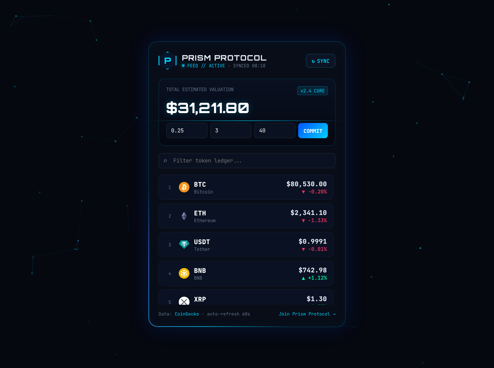
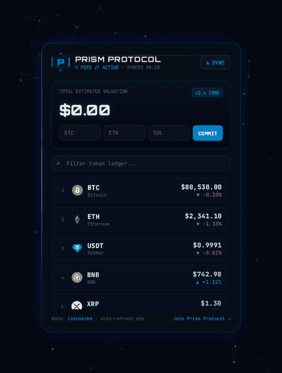
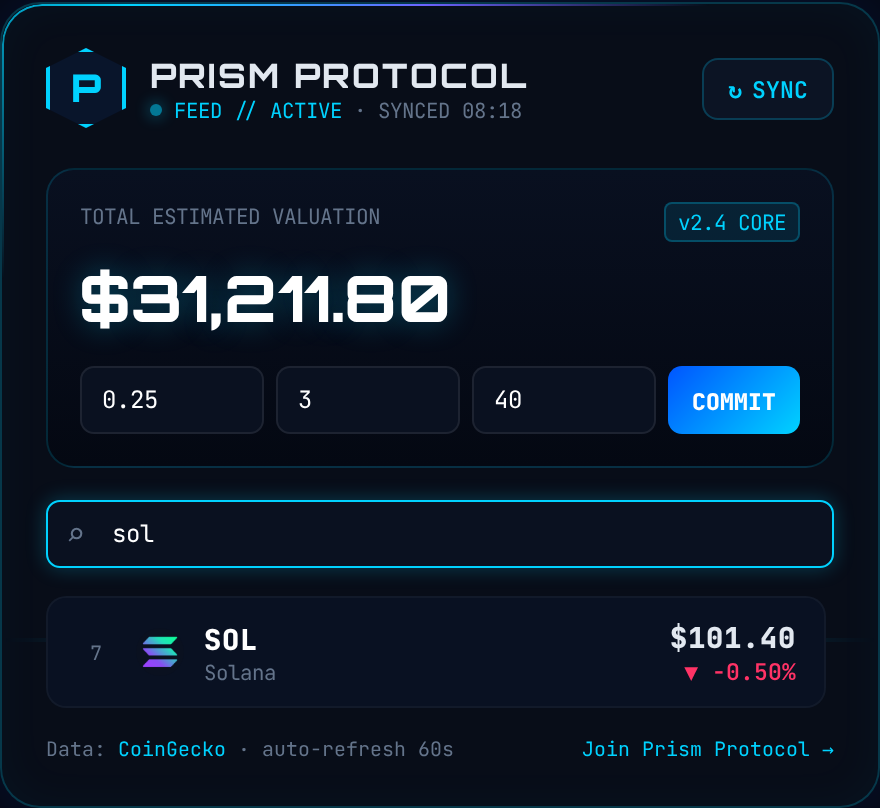
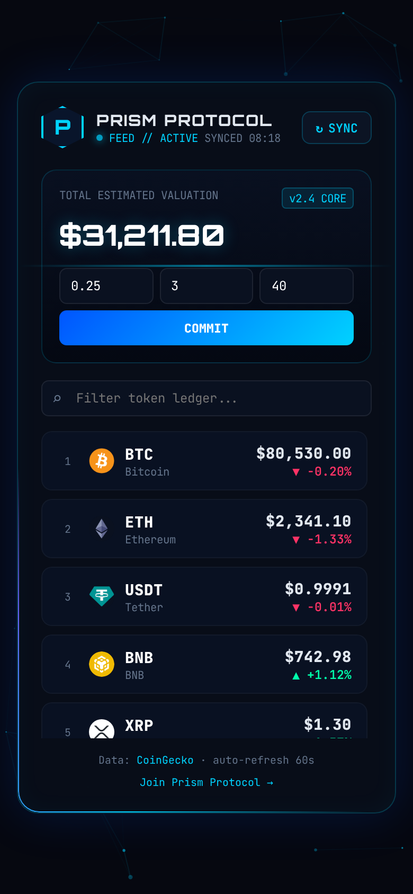
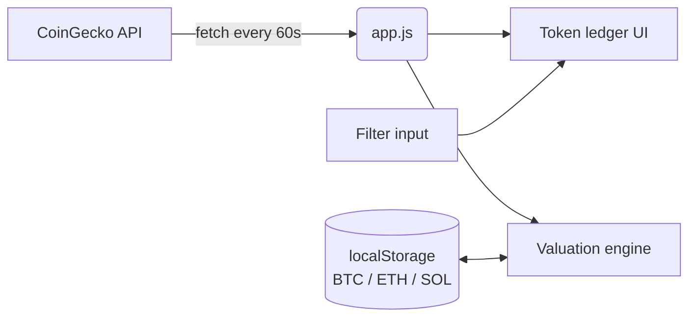

<!-- ═════════════ HEADER ═════════════ -->
<p align="center">
  
</p>

<p align="center">
  
</p>

<p align="center">
  <a href="https://krishyaa06.github.io/prism-crypto-tracker/"></a>
  
  
  
  
  <a href="LICENSE"></a>
</p>

<p align="center">
  <a href="https://krishyaa06.github.io/prism-crypto-tracker/"></a>
</p>


## ⚡ Overview

**Quantum Tracker** is a cyberpunk-styled cryptocurrency dashboard by **Prism Protocol**.
It streams live market data for the top 25 coins, lets you filter the ledger instantly and calculates the value of your **BTC**, **ETH** and **SOL** holdings. Everything runs in the browser: no sign-up, no backend, no tracking.

## 🎬 Demo

<p align="center">
  
</p>

## ✨ Features

| | Feature | Details |
|---|---|---|
| 📡 | **Live market feed** | Top 25 coins by market cap from the CoinGecko public API, with logo, rank, price and 24h change |
| 🔄 | **Auto-refresh** | Silent refresh every 60 seconds (paused when the tab is hidden), plus a manual **SYNC** button with a spinning indicator |
| 💼 | **Portfolio valuation** | Enter BTC / ETH / SOL quantities and press **COMMIT** (or `Enter`); the total counts up with an animation |
| 🔒 | **Private by design** | Holdings are saved only in your browser's `localStorage` |
| 🔍 | **Instant filter** | Search by name or symbol; the filter stays active after every refresh |
| 💲 | **Smart price format** | `$80,530.00` · `$0.9991` · `$0.00001234`, so small-cap coins never show as `$0` |
| 🌌 | **Animated UI** | Particle network background, scanning laser, rotating neon border, staggered row entrance |
| 📱 | **Responsive and accessible** | Mobile-first layout, ARIA labels and `prefers-reduced-motion` support |

## 🖼️ Screenshots

<table>
  <tr>
    <td align="center" width="55%"><br><sub><b>Instant token filter</b></sub></td>
    <td align="center" width="45%"><br><sub><b>Mobile view</b></sub></td>
  </tr>
</table>

## 🚀 Getting Started

```bash
# 1. Clone
git clone https://github.com/krishyaa06/prism-crypto-tracker.git
cd prism-crypto-tracker

# 2. Serve locally (needed for the API fetch to work reliably)
python -m http.server 8081
# → http://localhost:8081
```

> **Note:** The free CoinGecko API has rate limits. If you see *"API RATE LIMIT HIT"*, wait about a minute and press **SYNC**.

## ⚙️ How It Works



## 📁 Project Structure

```text
prism-crypto-tracker/
├── index.html              # Layout: header, valuation card, filter, ledger
├── style.css               # Cyberpunk theme and animations
├── app.js                  # Canvas background, API feed, portfolio logic
├── assets/
│   └── screenshots/        # README images and demo GIF
├── LICENSE
└── README.md
```

## 🗺️ Roadmap

- [x] Live top-25 market feed
- [x] Local BTC / ETH / SOL portfolio
- [x] Auto-refresh and smart formatting
- [ ] Add any coin to your portfolio
- [ ] 7-day sparkline charts
- [ ] INR / EUR currency switch
- [ ] Price alerts

## 🤝 Contributing

1. Fork the repo
2. Create a branch: `git checkout -b feature/amazing-idea`
3. Commit: `git commit -m "Add amazing idea"`
4. Push and open a Pull Request

## 👤 Author

<table>
  <tr>
    <td align="center">
      <a href="https://github.com/krishyaa06"><br><b>Soumya Bhandare</b></a><br>
      <sub>Founder @ Prism Protocol</sub>
    </td>
    <td>
      <a href="https://dc.gg/prismprotocol"></a><br>
      <a href="https://instagram.com/prism_protocol_"></a><br>
      <a href="https://x.com/krishyaa06"></a>
    </td>
  </tr>
</table>

## 📄 License

Released under the [MIT License](LICENSE). Market data provided by [CoinGecko](https://www.coingecko.com).

> ⚠️ This tool is for informational purposes only and is not financial advice.

<p align="center">
  <b>If you like this project, consider giving it a ⭐</b><br>
  <sub>"Build. Create. Compete." · Made with ⚡ by Prism Protocol</sub>
</p>


